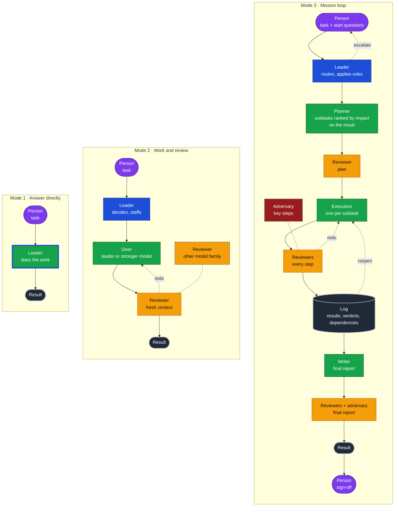

# mission-leader

[](LICENSE)


[](#install)

A skill that lets an AI agent decide how to run a task and hold the result to a checked standard. For each task it picks one of three modes:

1. **Answer directly.** For short, low-stakes tasks that can be checked at a glance. The agent does the work itself, with no review.
2. **Work and review.** The default for most research and analysis. The agent does the work itself or gives it to a stronger model, and an independent reviewer checks the result.
3. **Mission loop.** For long, multi-stage, or high-stakes work. The agent plans the mission, runs subtasks in order of their impact on the result with a worker for each, has every step reviewed, and reopens earlier results when later work shows they were wrong.



Blue: leader, which decides and routes. Green: doers. Orange: reviewers. Red: adversary. Purple: the person. Dark: results and the shared log. Dashed boxes are optional; dashed arrows send work back.

## Install

1. Install the skill:

   - **With Node.js** 22.20 or later, run in your project:

     ```
     npx skills add keyhell/mission-leader
     ```

     Add `-g` to install it for all your projects, and `-a <agent>` to choose the tool (for example `-a claude-code`, `-a opencode`, `-a codex`, `-a cursor`). The installer is the open [skills CLI](https://github.com/vercel-labs/skills).

   - **Without Node.js**, copy this repository into your skills folder as `mission-leader`. For Claude Code:

     - one project: `<project>/.claude/skills/mission-leader/`
     - all your projects: `~/.claude/skills/mission-leader/`

     For example: `git clone https://github.com/keyhell/mission-leader ~/.claude/skills/mission-leader`

2. Add one line to your `CLAUDE.md` or `AGENTS.md`, so the skill loads whenever it matters:

   ```
   For research, simulation or quantitative analysis whose result someone will rely on, use the mission-leader skill.
   ```

3. Start a task. The first time the skill runs, it asks a few set-up questions (which models to use and how to reach models from other providers) and, with your OK, saves the answers in that same file.

## Credit and contact

You can use mission-leader for anything, commercial or private, under the [MIT license](LICENSE). If you do, please mention this repository and its author, Alexei 'keyhell' Zhurba ([github.com/keyhell/mission-leader](https://github.com/keyhell/mission-leader)).

If you need help, or want to share how you use it, [open an issue](https://github.com/keyhell/mission-leader/issues). I'd like to hear about your case.
